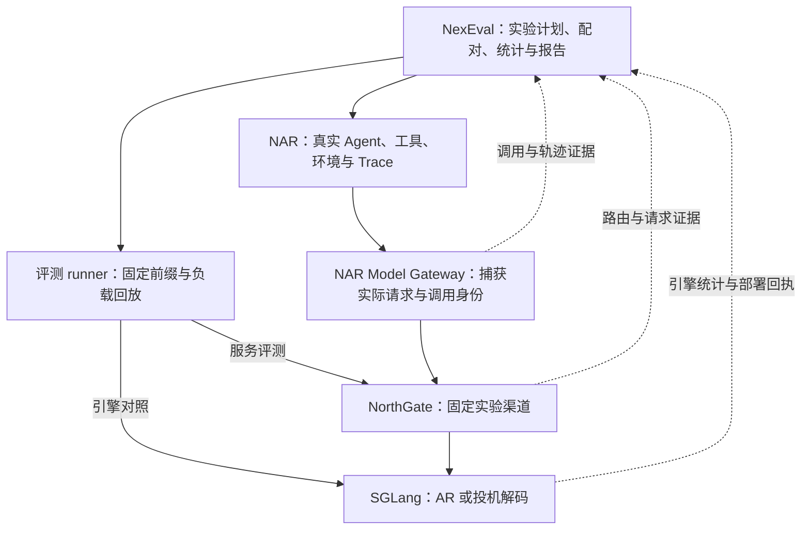

# NAR + NexEval + NorthGate + SGLang 投机解码评测设计

> 归档说明：本记录于 2026-11-09 收录到 NexSpecTrainer，保留 2026-11-02 的调研结论与版本边界。它不是当前实现状态或已复现的 benchmark 结果；执行实验前应重新核对对应版本与入口。
> 来源会话：`01a19ad7-5f41-7bb0-ba02-0d5bd8ec04ea`（梳理投机采样评测方式）。

日期：2026-11-02。状态：设计建议；本次只读核对源码和文档，未修改业务代码、创建渠道、部署或运行 GPU 测试。

## 1. 目标与推荐结构

这套栈最有价值的能力，是把投机解码的引擎收益与真实 Agent 任务收益联系起来。建议建立三个共享实验身份与证据格式的评测路径：

1. **固定前缀回放**：同一个模型请求分别交给 baseline 与 speculative 引擎，测真实生成性能。
2. **服务负载回放**：使用固定请求集合和请求到达计划，测拥塞、吞吐与延迟目标。
3. **真实 Agent 闭环**：NAR 驱动真实工具和环境，NexEval 使用原生 verifier 评分，测任务成功率与完成时间。

固定前缀只固定一次调用的输入，之后由被测引擎自行生成。把标准答案逐 token 强制喂给模型是另一种 teacher-forced 诊断，不能作为线上解码加速结果。



NAR 可以管理评测 runner 所属 Job/TaskRun 的生命周期。低层负载生成应由一个 runner 控制一整个测量窗口，避免为每条模型请求创建一个 AgentRun，让任务调度污染请求到达过程。

## 2. 已核对的基础与缺口

以下结论针对核对的 checkout，不能视作生产部署状态。

| 模块 | 已有基础 | 需要补齐或验证 |
|---|---|---|
| NexEval | 不可变 benchmark revision、有效配置的 `plan_digest`、NAR Job/worker、TrialResult、评分与 provenance、Trace 引用 | 推理部署快照进入实验身份；模型请求级性能证据；固定前缀和负载窗口执行方式；性能聚合规则 |
| NAR | Model Gateway 捕获 ingress 与实际上游 transport；logical call、agent、context epoch、call purpose；narperf 可观测上游重试 | 保存/导出足以重发的请求；logical call 与每次 NorthGate/SGLang 物理请求的映射；完整性校验 |
| NorthGate | 渠道、模型映射、路由、SSE 转发、外部 request ID 采集回显、内部请求 ID、渠道维度指标 | 实验渠道固定配置及生效快照；逐 attempt 的实际上游身份；SGLang 统计保留或旁路导出；请求关联透传验证 |
| SGLang | 已有 speculative counters 与 request `meta_info` 汇总；核对的版本在 OpenAI Chat 流式/非流式路径都构造 `sglext.spec_tokens_details` | 锁定具体算法/模型支持；验证私有部署版本及网关转换是否保留这些扩展；必要时补充旁路结构化记录 |

特别注意：

- NexEval 现有 `integration-tests/replay` 返回录制的 assistant 回复，用于运行时回归。它不能用于测投机解码速度，后者必须调用真实引擎。
- NAR 的内部 agent/epoch/purpose headers 在出站时会被剥离，现有文档明确尚无完整 NorthGate provenance envelope。不能假设各层已经共享完整 Trace 身份。
- NorthGate 的 `X-NorthGate-Model` 回显调用方请求的模型名，不能证明实际 target checkpoint。实际渠道、引擎配置和权重版本应从可信管理证据读取。
- 当前 NexEval 模型配置主要记录模型名、URL、协议与 defaults。相同 URL 的服务换了权重或 draft 后，若实验计划没有记录部署快照，现有 plan digest 不足以区分实验。

## 3. 职责分配

### NexEval：拥有实验定义和结果

建议在 NexEval 内形成一个推理性能评测模块，集中处理以下变化：

- 读取 workload revision 与固定实验配置。
- 调用固定前缀 runner 或负载 runner，复用现有真实任务 adapter。
- 对同一 task/request 在各实验配置间配对。
- 收集请求级原始计数、时间样本与部署证据，派生图表。
- 把 correctness、infrastructure failure、measurement invalid 分开表示。

第一版不必建新的实验服务。可以用一个小型外部 runner 先生成 evidence manifest，由 NexEval 结果引用；接口稳定后再内化为模块。不要把高频请求事件逐个写入 NAR 控制面。

NexEval 的质量评分和性能统计保持语义独立。`tokens/s`、P95、goodput 不能直接放入现有按题平均的质量排行榜，必须用适合该指标的统计口径。

### NAR：拥有真实执行和轨迹

复用 AgentRun/TaskRun、工具执行、环境重置、Trace 与原生 verifier。投机算法、draft tree 和 block size 对 Agent harness 透明。

在固定前缀数据导出时，优先使用实际发往模型服务的请求证据，保存 tools、tool_choice、response_format、sampling、reasoning/thinking 参数及所有模型可见内容。NAR ingress 请求与最终 SGLang 输入可能经过协议桥和 NorthGate 转换，应分别保存摘要并验证转换一致。

原始 Calog 比归一化后的可读 Trace 更适合作为精确重发源；但对于 `previous_response_id`、服务端会话引用、临时 URL 等有状态输入，必须物化引用或明确记录无法独立回放，不能默默补齐。

### NorthGate：拥有可审计的实验路由

baseline 与 speculative 各绑定受控实验渠道/部署回执，路由在一次实验内保持稳定。模型可见名称尽量相同，实验变体保存在路由和评测身份中，避免别名改变 harness 行为或 chat template。

算法对照禁用会跨实验配置切换的 fallback；允许的重试必须仍落在同一配置，并完整记录每次 attempt。生产策略实验可以单独保留真实重试和路由规则，报告它们的成本。当前权限与配置契约需在实现时确认，不假设已有一个通用的 `pin_channel` 请求参数。

已核对 NorthGate 现有机制：令牌 `retry_times=0` 可以禁止额外尝试；管理员有 `specific_channel_id` 定向机制，文档定义为 API key 后缀选定渠道，禁用 fallback/retry，并绕过普通渠道选择。该机制适合定向验收，但会绕过部分真实路由行为；服务负载实验更适合使用明确隔离的候选池和配置快照。不要为了方便把管理员凭据暴露给 harness。

NorthGate 不负责计算 token 接受率，不负责管理草稿模型训练，不负责派生 benchmark 总分。

### SGLang：拥有推理实现和原始计数

投机参数通常属于引擎启动配置。把它们作为不可变 deployment variant 管理，通过部署或独立实例切换；不要假设可以在每个 OpenAI 请求中即时开启/关闭算法。

同一批 GPU 可以按实验窗口串行运行 AR 与 speculative，使用随机化或交替顺序降低漂移。如果并行跑，需要等价且隔离的硬件，不让两组争用同一 GPU。

最小接入优先尝试已有 OpenAI Chat 扩展：请求 `return_spec_tokens_details=true`，读取响应 `sglext.spec_tokens_details`。核对的 `serving_chat.py` 在流式尾部可发送 `choices=[]` 的扩展 chunk，在非流式响应顶层构造 `sglext`。网关若跳过空 choices chunk、只重建标准 DTO，可能损失证据，必须分别验证 stream/nonstream、Chat 原生与 Responses/Anthropic 桥接路径。静态搜索 NorthGate 的 DTO、relay 和 API 文档未找到这些字段的专门处理；这不能证明字段必然丢失，但不能声称链路已支持。

统计由 Gateway capture 保存即可，不要求 harness 理解扩展字段。详细 draft/verify kernel 时间不包含在这组 counters 中，另用引擎 profile 获取。

## 4. 三种评测协议

### 4.1 固定前缀：定位算法收益

从真实 baseline 轨迹抽取首轮、中间轮、工具反馈后、压缩后、子 agent 等请求。保留失败任务，按 task 切分开发/测试，避免同一任务不同轮次跨集合。

每个样本至少包含：源 task/trace/call 身份、完整实际请求、目标 tokenizer/template revision、prompt token 长度、sampling、最大输出、stop 条件、上下文阶段，以及可选的引擎实际 input token IDs 摘要。

先用同一 SGLang 版本直接跑两组配置；再以同一批请求经过 NorthGate，验证协议转换与转发没有改变实验条件。报告两个路径自己的结果，不通过两条不配对曲线相减估计网关开销。

起步使用 greedy，再加入目标模型推荐的随机采样参数。随机采样下相同 seed 不保证输出逐字相同；记录实际输出长度，按足够多请求与重复分析分布和质量。固定 token 数的引擎微基准与自然 EOS 的真实请求实验分别报告。

### 4.2 服务负载：测延迟—吞吐关系

用一个 runner 持有整段请求序列和时钟；请求集固定，调度器只负责按预定规则发送。报告两种负载：

- **Closed-loop**：维持 C 个在途请求，完成一个再发下一个，用于并发扫描。
- **Open-loop**：按固定 arrival schedule 或固定种子的到达过程发送，用于容量、排队和 SLO 测量。

Open-loop 记录计划发出、实际发出和响应时间，不能因负载发生器阻塞就悄悄降低 offered load。报告 offered/completed/failed/cancelled 请求数和排空策略，避免 coordinated omission。

起步可扫描模型请求并发 `1, 4, 16, 32`；这是建议，不是某论文完整复现协议。输入长度按真实目标 tokenizer 分桶，例如短、中、长三桶。第一轮不要把所有模型、harness、长度、算法、采样组合做成巨大笛卡尔积。

区分：

- NexEval trial concurrency：同时执行多少个评测任务。
- NorthGate upstream in-flight：当前真正调用模型的请求数。
- SGLang scheduler batch：某一步实际参与推理的序列/ token 集合。

三者相关但不相等。Agent 等待工具时不消耗模型请求并发；prefill、decode 和投机验证也有不同批处理形态。

### 4.3 真实 Agent 闭环：测最终价值

在固定任务 revision、harness 版本、工具配置和初始环境上各跑 baseline 与 speculative，让后续轨迹自然展开。不要把前一组工具输出塞给后一组并称之为真实闭环。

推荐首批选一个已在 NexEval 激活的 coding benchmark 与一个工具调用 benchmark，例如 SWE-bench Verified/DeepSWE 与 BFCL multi-turn。具体题集必须按实际 catalog readiness 选择。

同时记录：原生任务质量、完整 task walltime、Agent 执行区间、模型请求区间、工具区间、环境准备/清理、verifier 和 Trace 就绪时间。子 agent 与工具可能并发，这些时间不能直接相加当总耗时。

固定 token/turn 预算下比较质量和速度；固定时间预算下的成功率作为第二组实验。后者可能因更快生成而允许更多尝试，属于新的收益口径，不能混入前者的“质量无损”论证。

若串行场景模型耗时占比为 f，模型加速比为 s，则理想任务加速约为 `1 / ((1-f) + f/s)`。并发 Agent 应通过实际时间线或关键路径分析，不能把累计模型耗时占比直接代入。

## 5. 最小证据接口

以下是建议新增的逻辑数据结构，不是声称仓库已有这些 API。先围绕三类记录实现，避免四个仓库各造一套实验对象。

### Deployment receipt

由可信部署/管理侧生成，NexEval 冻结引用和摘要：

```text
deployment_id, revision, config_digest
target_checkpoint_revision, draft_checkpoint_revision
tokenizer_revision, chat_template_digest
sglang_commit, container_digest, GPU型号/数量, TP/DP
precision/quantization, attention_backend, CUDA graph, scheduler
speculative_algorithm, draft/tree/block 配置
KV/prefix-cache 配置, memory limits, max_running_requests
NorthGate 渠道配置摘要, NAR ModelRoutePolicy 摘要
```

计划里的期望配置与实际加载的配置要分别记录并比对。路由配置、引擎重启或权重改变时，结束当前测量窗口或标记 invalid。GPU 型号、数量、精度等不必进普通模型响应，可以作为受控结果证据引用。

### Workload item / load schedule

```text
workload_revision, source_task_id, source_call_id, split
request_artifact, request_digest, input_token_digest（如可得）
phase, prompt_tokens, expected_output_length_bucket
sampling/stop/max_new_tokens, scheduled_offset（负载模式）
```

提示与工具数据留在受控 artifact，报告和指标标签只引用身份。对数据做脱敏会改变 token 分布；改变后的版本应有独立摘要并重新计算输入长度。

### Request observation

```text
experiment_id, variant_id, cell_id, repetition_id
task_id, agent_run_id, logical_call_id
physical_attempt_id, northgate_request_id, engine_request_id
deployment_revision, request_digest
status, retry_index, cache/replay_hit, finish_reason
scheduled/send/first_content/completion 时间及各层本地 duration
prompt_tokens, completion_tokens, cached_tokens
verify_steps, accepted_draft_tokens, proposed_draft_tokens
raw_engine_stats, schema_version, coverage/缺失原因
```

第一步可以复用 NorthGate 的 `X-Request-ID` 与返回的 `X-NorthGate-Request-ID` 建立映射，由 NAR 记录每次物理 attempt。NorthGate 到 SGLang 是否保留该 ID、SGLang 如何映射到内部 rid 需要验证或补实现。无需先向 NorthGate 暴露所有 NAR 内部身份，也无需先完成完整 provenance envelope。

ID 关联来自显式映射，不能按 prompt 相同或时间接近猜测。请求 ID 不作为 Prometheus label；逐请求证据放入结构化日志或 artifact，Prometheus 保持低基数。

## 6. 指标定义与计时约束

| 指标 | 建议定义/处理 |
|---|---|
| 接受长度 | `sum(committed output tokens attributable to verify rounds) / sum(verify rounds)`；记录 bonus、prefill 首 token、EOS 与截断计数规则 |
| 草稿接受率 | `sum(accepted draft tokens) / sum(proposed draft tokens)`；保留算法原始定义，树形候选数与链式条件接受率不能当同一指标 |
| 系统输出吞吐 | 测量窗口内有效输出 token 数 / 窗口 walltime；区分请求完成与 token 发出的窗口口径 |
| 单请求速度 | 每请求输出 token / 对应生成时间；不要把每请求速度的算术平均当系统吞吐 |
| TTFT | 请求实际发出至首个有效生成内容；另记 first byte，不能把 SSE role-only chunk 算首 token |
| TPOT/流式体验 | 明确公式、首 token 和不足两 token 的处理；另外报告可见 chunk 间隔和长停顿 |
| Goodput | 成功且满足预先定义 TTFT/延迟目标的请求数 / 时间；若用 token goodput，另名并明确分母 |
| Agent 效益 | 原生成功率、任务耗时分布、完整成本/成功任务数；失败任务消耗也计入成本 |

在核对的 SGLang commit 中，`spec_accept_length = completion_tokens / verify_ct`（包含 bonus），`spec_accept_rate = num_correct_drafts / num_proposed_drafts`（不含 bonus）；proposed 数由 `verify_ct * (num_draft_tokens - 1)` 推导。平台要保留这些原始统计及版本，不能对动态 draft/tree 的其他实现直接套用固定长度公式。

SSE chunk 可以被引擎、detokenizer、协议桥、网络缓冲重组。**一个 chunk 不是一个 token，也不是一次验证轮次**。引擎接受率从引擎 counters 获取；网关 chunk 时间只说明客户端可见的流式交付。

各层 duration 使用本地单调时钟。未经时钟校准，不直接用两个主机的绝对时间戳相减计算微小开销。NAR narperf 当前是已观测记录与区间统计，不是完整 GPU profile 或自动关键路径分析。

## 7. 实验公平性

1. **同硬件预算**：AR 与 speculative 使用相同总 GPU 数和型号；如果 draft 使用额外 GPU，另报告总 GPU-seconds、成本和 iso-resource 对照。
2. **同输入语义**：锁定实际 tokenization、chat template、thinking、tool schema、grammar/JSON 约束、stop 与最大长度。先用小量请求核对端到端转换。
3. **缓存独立**：进程/kernel 预热与 prefix-cache 预热分开；冷缓存基线与现实暖缓存分别测。不同组之间重置或使用严格对称的预热计划。
4. **防止模型回复重放**：每次测量使用新的合法实验/调用身份，检查是否真实触达 SGLang。NAR logical-call replay 只是传输恢复能力，不能被算作推理加速。不要通过给 prompt 添加随机 nonce 来逃避缓存，这会改变实验输入。
5. **固定测量窗口**：记录 warmup、测量、drain；分离服务器启动、权重加载与稳定态。控制 GPU 温度/功率策略和同时运行的其他任务。
6. **完整失败证据**：超时、重试、取消、丢流、路由漂移、统计缺失分别报告。基础设施失败不冒充模型答错，分析也不能只留下成功请求。
7. **统计配对**：按源 task 聚类 bootstrap，保留相同 task 下各请求的相关性。先做至少 3 个交替/随机化的测量窗口用于发现噪声，再按区间宽度与研究问题增加重复；不要把这个起步数当充分统计保证。
8. **校准采集开销**：轻量 counters 用于主结果；逐 token、逐 kernel profile 单独跑诊断窗口，测量额外开销。

## 8. 实施顺序与最小验收

### 阶段一：闭合身份和证据链

一个 target、一种已验证支持的 drafter、AR 与 speculative 两个部署配置、少量文本与工具调用请求。先验证真实引擎执行、路由不漂移、请求输入一致、output usage 和 spec counters 能回收到 NexEval。缺失指标明确 unknown，不填零。

验收：每个逻辑调用可解释其物理 attempts；每个实际引擎请求可关联部署版本；重复 HTTP 交付不会重复计为有效输出；计时覆盖范围明确。

### 阶段二：固定前缀性能回放

建议从真实任务按长度和阶段抽取约 200 个请求作为开发集，另按 task 隔离测试集。先测单请求，找出 draft/verify 成本与接受长度关系，再扫少量并发。样本量只是开发起点，正式结论依据覆盖和不确定性。

验收：同一请求两种配置都能真实生成；没有固定响应 replay；报告原始计数、绝对速度和配对差异，能解释异常值。

### 阶段三：服务负载与真实闭环

增加 open-loop 负载与更长上下文；随后选定已激活的 benchmark 完成真实 Agent A/B。两个路径共享变体身份、证据与报告，不共享错误的并发假设。

验收：给出适用区域，例如短/长上下文、低/高负载下何时获益、何时退化；同时说明任务级收益、质量和系统成本。

真正执行 NAR E2E 时统一经 `hk-linlizhi-jumpserver` 使用 `narctl` 管理隔离部署，先读 `narctl-e2e` skill 和对应 checkout 的 CLI/recipe 文档，先 discover/status/operation 查已有部署。SGLang GPU 服务另按 GPU 平台已授权流程管理。本设计不假设 narctl 已能部署 SGLang 或 NorthGate。

## 9. 本次证据来源

- NAR checkout：`/Users/shom/Downloads/nar-rc1102-additions-20261031`，HEAD `f7726bb6f64abfaeff8f41b8c98529506b0f7175`。核对 `docs/model-gateway-metadata-protocol.md`、`docs/narperf.md`、`docs/nexrl-weaver-training.md`。这是本地分支快照，未证明相同版本在生产运行。
- NexEval source snapshot：`/Users/shom/Downloads/research/nexeval-seven-benchmarks-20261028/nexeval`。无 Git 元数据；核对 `src/nexeval/models.py`、`src/nexeval/service.py`、`docs/nar-job-worker.md`、`integration-tests/replay/README.md`。其根 README 的“设计阶段”描述与实现并不完全同步，本建议以具体代码/文档为证据。
- NorthGate：SSH 主机 `hk-linlizhi-jumpserver` 的 `/root/NorthGate`，HEAD 短 SHA `47b3d37d`。先查 `docs/api-reference.json` 的 route inventory，再查 `docs/backend/headers.md`、`docs/backend/relay-pipeline.md`、`docs/backend/routing/channel-routing.md`、`docs/ops/metrics.md`。未读取生产配置或修改服务。
- SGLang：GitHub main 于本次核对解析到 `3d33971dea1762fe2cc6dc8ec8172eecf3d6a3a4`。原始统计定义见 [spec_decoding_metrics.py](https://github.com/sgl-project/sglang/blob/3d33971dea1762fe2cc6dc8ec8172eecf3d6a3a4/python/sglang/srt/speculative/spec_decoding_metrics.py)，汇总调用见 [tokenizer_manager.py](https://github.com/sgl-project/sglang/blob/3d33971dea1762fe2cc6dc8ec8172eecf3d6a3a4/python/sglang/srt/managers/tokenizer_manager.py)，OpenAI 扩展见 [protocol.py](https://github.com/sgl-project/sglang/blob/3d33971dea1762fe2cc6dc8ec8172eecf3d6a3a4/python/sglang/srt/entrypoints/openai/protocol.py) 与 [serving_chat.py](https://github.com/sgl-project/sglang/blob/3d33971dea1762fe2cc6dc8ec8172eecf3d6a3a4/python/sglang/srt/entrypoints/openai/serving_chat.py)。没有证明当前 North 私有部署使用该 commit。
- 相关论文设置详见[投机解码评测协议调研与平台适配参考](./related-evaluation-protocols.md)，由独立 subagent 核对。
